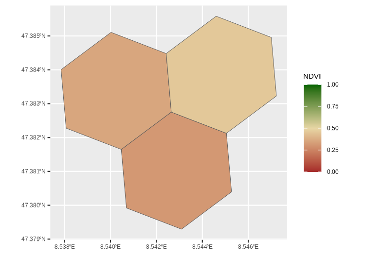

# traktr <a href='https://da-wi.github.io/traktr/'></a>

[](https://github.com/da-wi/traktr/actions/workflows/R-CMD-check.yml)
[](https://lifecycle.r-lib.org/articles/stages.html#experimental)
[](https://opensource.org/licenses/MIT)

## Overview

The `traktr` package provides a tidy workflow for enriching GPS tracking
data from Sentinel-2 imagery and related products. It supports both
H3-based and buffer-based areas of interest (AOI), handles tiling,
querying and rate-limited downloads from the Copernicus Data Space
Ecosystem (CDSE), and attaches contextual statistics back to your GPS
data.

## Installation

Install with `pak`.

``` r
# install.packages("pak")
pak::pak("da-wi/traktr")
```

## Quick start

This snippet can be run offline. It creates the expected variables and
generates buffers around GPS coordinates.

``` r
library(traktr)
library(dplyr)
library(sf)

# Demo points
gps <- tibble(
  subject = rep("Z001", 6),
  timestamp = as.POSIXct(c(
    "2025-06-01 08:00",
    "2025-06-01 08:05",
    "2025-06-01 08:10",
    "2025-06-01 08:15",
    "2025-06-01 08:20",
    "2025-06-01 08:25"
  )),
  lat = c(
    47.37679857987844,
    47.3739359784768,
    47.37233750399134,
    47.37044833531484,
    47.36863176315391,
    47.36720934345714
  ),
  lon = c(
    8.539868485211397,
    8.538366448157388,
    8.53830207514079,
    8.539053093667793,
    8.539739739178195,
    8.544508706822644
  )
)

hex <- gps |> 
  mutate_aoi_h3(res=9) |> 
  fetch_ndvi(from = as.Date("2025-04-01"),
           to = as.Date("2025-07-31"),
           out_dir = "~/.ndvi",
           client = oauth, 
           resolution_m = 8) |>
  attach_ndvi() |>
  mutate(geometry = h3jsr::cell_to_polygon(h3)) |> 
  sf::st_as_sf(sf_column_name = "geometry", crs = 4326)


ggplot(hex, aes(fill = ndvi_mean))+
  geom_sf() + 
  scale_fill_gradient2(
    low = "brown",
    mid = "#E7D6A4",
    high = "darkgreen",
    midpoint = 0.5,
    limits = c(0,1)
  )+
  labs(fill = "NDVI")+
  theme(axis.text.x = element_text(angle = 45, hjust = 1))
```



## System requirements

- R ≥ 4.2
- For fetching Sentinel-2 data: [CDSE
  account](https://dataspace.copernicus.eu/).
- Optional: GPS_SMB_ROOT for your CSV data directory.

## Documentation

See the “Getting started” guide.

## Citation

Please cite `traktr` and data sources (Sentinel-2, ESA WorldCover) in
publications.

``` r
citation("traktr")
```

## Contributing

Contributions are welcome! Please open an issue for bug reports or
feature requests.
